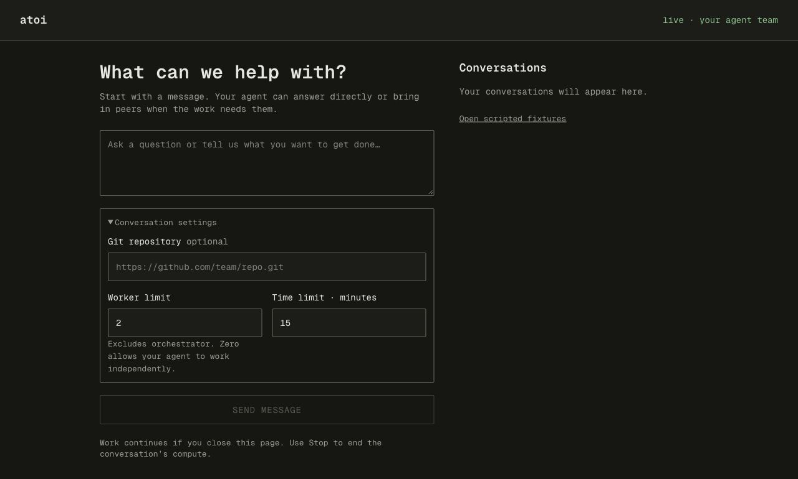
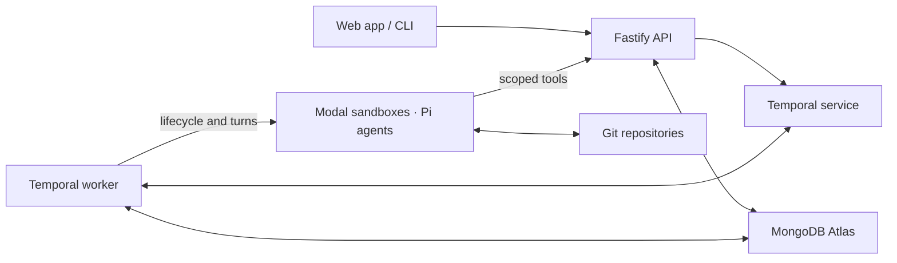

# atoi

**Persistent agent teams in the cloud.**

atoi brings a team of agents into one shared conversation. Each agent has its own
Modal sandbox, files, tools and native Pi session. Agents can divide up work,
consult peers directly and return to earlier investigations when a new question
comes up. Shared tasks, messages and versioned evidence keep the team coordinated.

The project is an experimental prototype. Agents stay available across turns and
tasks within a run; completing the run stops compute. Reusing a team across
completed runs is planned.

[Quick start](#quick-start) · [Architecture](#architecture) ·
[Documentation](#documentation) · [Contributing](#contributing)



## What you can do

- Start a conversation in the web app or CLI. An orchestrator chooses worker roles
  and requests peers within your configured limit.
- Give each agent a private cloud workspace for code, notes, dependencies and
  experiments. Research and planning runs do not require a Git repository.
- Collaborate through a team channel and direct messages. Addressed messages and
  durable timers wake agents for another turn.
- Track tasks with atomic ownership, acceptance criteria and optional peer review.
  Requested code reviews check the exact submitted commit.
- Continue from native Pi session checkpoints stored in Atlas. Task completion
  leaves an agent available for follow-up while its run remains active.
- Inspect recorded activity, tool results, working notes and model usage. Refreshing
  or closing the browser does not cancel work; Stop and run deadlines drive cleanup.

The design keeps useful context in agent sessions, files and published artifacts.
Its potential benefits for inference scaling, repeated work and handoff quality
are described in the [product story](docs/product-story.md) and
[context-scaling notes](docs/context-scaling.md). Cost and quality improvements
require comparison against a baseline.

## Quick start

### Preview the interface

Requires **Node.js 24+** and **pnpm 11.19.0**.

```sh
git clone https://github.com/WingchunSiu/atoi.git
cd atoi
pnpm install --frozen-lockfile
pnpm --filter atoi-dashboard dev
```

Open [the scripted demo](http://127.0.0.1:5173/?source=mock). These fixtures show
team chat, task handoffs and recovery events without credentials, a database,
model calls or cloud sandboxes. They are explicitly labeled mock data.

### Run a real team

You need MongoDB Atlas or a MongoDB replica set, a Modal account, a model API key
and `cloudflared` on your PATH. A standalone MongoDB server does not support the
transactions used by the harness. The demo runner starts its own persistent local
Temporal service and worker.

```sh
cp .env.example .env
```

Fill in the placeholders using the following configuration:

| Setting | Purpose |
| --- | --- |
| `MONGODB_URI`, `MONGODB_DATABASE` | Coordination records and session checkpoints. Allow the backend host to connect and create indexes. |
| `ADMIN_TOKEN`, `AGENT_TOKEN_SECRET` | Separate operator and agent secrets, each at least 32 URL-safe characters. |
| `BACKEND_PUBLIC_URL` | Set to `http://127.0.0.1:3000` for the demo runner, which supplies its tunnel URL to guests. Separate services need a reachable HTTPS URL. |
| Modal profile or `MODAL_TOKEN_ID`, `MODAL_TOKEN_SECRET` | Sandbox lifecycle access held by the trusted backend. |
| `ATOI_MODEL_API_KEY` or `MODAL_MODEL_SECRET` | Model access for Pi. A named Modal Secret must contain `ATOI_MODEL_API_KEY`. |
| `PI_PROVIDER`, `PI_MODEL` | A provider/model pair supported by the pinned Pi SDK. The example uses `openai` and `gpt-4.1`. |
| `MODAL_GIT_SECRET` | Optional named Secret containing a repository-scoped `GITHUB_TOKEN` for GitHub HTTPS clones and pushes. |

Generate each operator/agent secret separately:

```sh
node -e "console.log(require('node:crypto').randomBytes(32).toString('hex'))"
```

Stop the preview server, then build and launch the local live demo. The runner
uses ports 3000 and 5173.

```sh
pnpm build
pnpm demo:web
```

Set `CLOUDFLARED_PATH=/path/to/cloudflared` if the executable is not on your PATH.
Open [the dashboard](http://127.0.0.1:5173/) and send a bounded objective. For a
follow-up demo, explicitly ask the team to wait before finishing the run:

> Compare two approaches to parsing quoted CSV fields. Ask a peer to review the
> reasoning, record the evidence, and wait for my follow-up before finishing the run.

Inspect the conversation and activity, then ask a related question. Use **Stop**
when finished. Optional conversation settings control the repository, worker cap
and time limit. The worker limit excludes the orchestrator and can be zero.

The runner starts the API, HTTPS tunnel, Temporal service, worker and dashboard.
It stores demo records in isolated `browser_*` collections in the configured
MongoDB database and preserves local Temporal history in `.atoi/browser-temporal.db`.
No seed step or automatic database reset is needed. Records remain after compute
stops. Ctrl-C stops this demo's active runs; idle sandboxes remain alive and billed.

For separate API/worker processes, a disposable local replica set or hosted
services, follow [runtime setup](docs/runtime.md) and
[deployment boundaries](docs/deployment.md). Keep credentials out of source control.
The included browser gateway is for local development; hosted operator
authentication remains to be implemented.

## CLI

With the API and Temporal worker running, the CLI uses the same backend:

```sh
pnpm cli start - "Research this question and return a sourced comparison" 2
pnpm cli start https://github.com/<team>/<repo>.git "Implement and independently review a bounded fix" 2
pnpm cli status <runId>
pnpm cli message <runId> <agentId> "Check your earlier finding under this new condition."
pnpm cli history <runId> [agentId] [afterCursor]
pnpm cli watch <runId> [agentId] [afterCursor]
pnpm cli stop <runId>
```

Use `-` for work without a repository. The final `start` argument is the worker
limit: default 2, range 0–8, excluding the orchestrator. The CLI reads
`BACKEND_PUBLIC_URL` and `ADMIN_TOKEN` from `.env`.

`pnpm demo` exercises task claims, messages and synthetic review evidence through
the API using logical agents. It creates a fresh run without model calls or
sandboxes and leaves its records for inspection. Use a dedicated demo database;
there is no shared-data reset command.

## Architecture



Fastify, the Temporal worker and the outbox/reconciler form the trusted control
plane. They enforce authorization, task ownership, worker capacity, retries,
deadlines and cleanup independently of the planning agent. Agents and browsers
receive no Atlas or Modal provider credentials.

Atlas holds runs, agents, tasks, conversations, deliveries, events and native Pi
checkpoints. Temporal owns scheduling and workflow history in its own service.
Each sandbox owns a private filesystem; Git holds shared project files and
artifacts at immutable commits. Agents exchange references and fetch work into
their own clones rather than editing one shared filesystem.

## Current limits

- Persistence is scoped to a run. Cross-run teams, semantic memory retrieval and
  automatic sandbox replacement are deferred.
- Recovery covers confirmed Pi checkpoints and pushed Git revisions. Uncommitted
  files, running processes and RAM have no replacement guarantee.
- Idle sandboxes are retained and billed. VM suspension and zero-cost waiting are
  not implemented.
- Task evidence and working notes are agent reports. Requested peer review is
  supported; a trusted evaluator is not implemented.
- A documented live E2E exercised Atlas, Modal, Pi, peer review, checkpoint history,
  private file reuse and cleanup against a read-only public Git commit. Private Git
  push remains unverified. See [verification details](docs/runtime.md).

## Development

```sh
pnpm check                            # TypeScript and Biome
pnpm test                             # Coordination and runtime suites
pnpm build                            # Backend and guest bundle
pnpm --filter atoi-dashboard test
pnpm --filter atoi-dashboard build
```

Integration tests start temporary MongoDB replica sets and local Temporal services.
The first run may download their executables. Model inference and sandbox operations
are scripted fixtures in local runtime tests. Use `pnpm test:unit` for checks that
need no database or network; `pnpm e2e` uses real cloud services and inference.

Coordination tests can use `TEST_MONGODB_URI` from the shell for an existing replica
set or Atlas. They create and remove a unique test database, never the configured
`MONGODB_DATABASE`; this command does not load `.env`. A disposable development
replica set is also available through `pnpm db:local`; its data is discarded when
stopped. Its URI is `mongodb://127.0.0.1:27017/?replicaSet=testset`.
See [test setup and permissions](docs/state-and-messaging.md).

## Documentation

| Guide | Contents |
| --- | --- |
| [Runtime](docs/runtime.md) | Credentials, separate services, CLI demos, integration evidence and recovery limits |
| [Dashboard](dashboard/README.md) | Live adapter, local gateway, offline fixtures and UI controls |
| [Orchestration](docs/orchestration.md) | Run admission, dynamic workers, timers, completion and API migration |
| [State and messaging](docs/state-and-messaging.md) | Task transitions, channel permissions, transactions and delivery |
| [Activity](docs/activity.md) | Recorded tool activity, working notes, replay and SSE |
| [Deployment](docs/deployment.md) | Local and hosted control-plane boundaries |
| [Product story](docs/product-story.md) | Persistent teams and the inference-scaling thesis |
| [Context scaling](docs/context-scaling.md) | Filesystem context, evidence, evaluation and deferred sharing |
| [Milestone 1](docs/milestone-1.md) | Scope and acceptance criteria |

## Contributing

Issues and focused pull requests are welcome. Include a reproducible problem,
relevant checks and any setup or migration changes. For UI work, include screenshots
or a short recording. Follow the [engineering and PR guidelines](AGENTS.md),
including preserving unrelated work and using squash merges.
